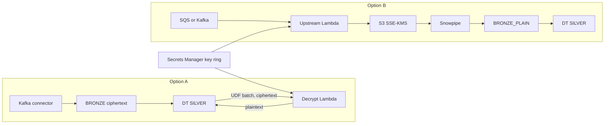

# Keep the PII key in AWS with incremental Dynamic Tables

Two runnable options for a silver layer on incremental Dynamic Tables where AES-encrypted PII is decrypted
**without the AES key ever entering Snowflake**. Both were deployed and tested end to end; see
[docs/results.md](docs/results.md).

> Personal "art of the possible" work by Kevin Keller (Snowflake). Not an official Snowflake solution, not reviewed
> or supported, not production-hardened. Review with your security and legal teams before adapting anything.

## The two options

| | A: Dynamic Table calls a decrypt service in AWS | B: Decrypt upstream, before Snowflake |
| --- | --- | --- |
| Flow | Kafka connector → `OPT_A.BRONZE` (ciphertext) → DT `OPT_A.SILVER` calls a VOLATILE vectorized External Access UDF → Lambda decrypts → plaintext back | Kafka (SQS here) → Lambda decrypts → S3 (SSE-KMS) → Snowpipe → `OPT_B.BRONZE_PLAIN` → DT `OPT_B.SILVER` |
| Key location | Secrets Manager, read only by the Lambda | Secrets Manager, read only by the Lambda |
| In Snowflake | ciphertext in bronze, EAI, secure UDF, caller-token secret | plaintext from bronze on, storage integration |
| Decrypt audit | Lambda log per call (column, rows, key ids, IP) + CloudTrail | Lambda log per batch + CloudTrail |
| Refresh cost | calls AWS on every refresh (about 10 s per 2,000 rows here) | plain SQL (under 1 s) |
| Pipeline change | small: swap the UDF | larger: consumer + S3 + Snowpipe instead of the connector |

Why not the obvious alternatives: external functions are not supported in Dynamic Tables, and an `IMMUTABLE` UDF
reinitializes the DT when it is replaced (re-decrypting all history). Details and per-option diagrams:
[docs/architecture.md](docs/architecture.md).



## Layout

| Path | What |
| --- | --- |
| `infra/app.py` | CDK stack: KMS key, key-ring + caller-token secrets, both Lambdas, SQS + DLQ, S3, Snowflake storage role |
| `lambda/` | `hhcrypto.py` (AES-GCM + cached key ring), `decrypt_api.py` (A), `upstream.py` (B) |
| `snowflake/` | `00_common` roles + PHI tag masking, `10/11` Option A, `20/21/22` Option B, `90_verify` checks |
| `client/` | `produce.py` synthetic upstream producer, `rotate_key.py` adds a key (plays the CI job) |
| `tests/` | unit tests for crypto and both handlers |

## Run it

Needs: `aws login` (or other AWS credentials), a `snow` connection, Docker, Node.js, [pixi](https://pixi.sh), uv.

```bash
export SNOW_CONNECTION=<your connection>
pixi run test            # unit tests
pixi run setup           # Snowflake objects + AWS stack (two CDK passes)
pixi run produce-a 1000  # encrypted records into OPT_A.BRONZE
pixi run produce-b 1000  # encrypted records into the SQS queue
pixi run rotate          # add a new AES key and make it current
snow sql -c $SNOW_CONNECTION -f snowflake/90_verify.sql
pixi run teardown
```

Secrets stay out of git: the key ring is generated straight into Secrets Manager, and the caller token goes from
Secrets Manager into a Snowflake secret through `.secrets/` (git-ignored).
