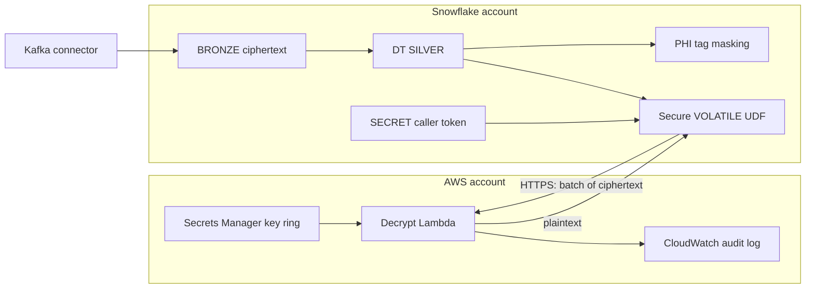
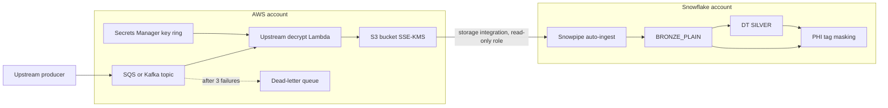

# Architecture

Starting point: PII arrives from upstream (Kafka) encrypted with AES-256-GCM. The AES key is held in AWS Secrets
Manager, and the security requirement is that the key does not leave AWS. The silver layer is built with incremental Dynamic
Tables, and decrypted columns are protected with tag-based masking.

Two ways to meet that requirement are shown here. Both keep the key in AWS; they differ in where decryption runs and in
what Snowflake holds.

## Why the usual options do not fit

| Approach | Status with incremental Dynamic Tables |
| --- | --- |
| External function (API Gateway + Lambda) | not supported in Dynamic Tables |
| Key copied into a Snowflake SECRET, decrypt in a UDF | works, but the key is then in Snowflake |
| UDF fetches the key from AWS at refresh time | works, but the plaintext key is in UDF memory during the refresh; an `IMMUTABLE` UDF reinitializes the DT when replaced |
| **A: UDF sends ciphertext to AWS, gets plaintext back** | works (this repo) |
| **B: decrypt in AWS before the data reaches Snowflake** | works (this repo) |

## Option A: the Dynamic Table calls a decrypt service in AWS



```mermaid
sequenceDiagram
  participant DT as DT refresh (SYSTEM user)
  participant UDF as DECRYPT_PII (vectorized)
  participant L as Decrypt Lambda
  participant SM as Secrets Manager
  DT->>UDF: new bronze rows only (incremental)
  UDF->>L: POST caller, items[kid, iv, ct, tag], bearer token
  L->>SM: GetSecretValue (cached, reloaded on unknown kid)
  L-->>UDF: plaintext per item
  Note over L: audit line: caller column, rows, key ids, source IP
  UDF-->>DT: values; any unexpected null fails the refresh
```

What Snowflake holds: ciphertext in bronze, plaintext in silver (masked), an External Access Integration limited to
the Lambda host, the secure UDF, and a caller token that allows decrypt requests. It does not hold the AES key.

Privileges: the pipeline role owns the DT and has USAGE on the UDF only. The UDF, secret and integration are owned by
a separate role and run with owner's rights.

Points to consider:

* The caller token is a credential in Snowflake. It allows decryption through the Lambda, not access to the key.
  It could be replaced by IAM-authorised calls or narrowed with network controls on the AWS side.
* Ciphertext leaves Snowflake and plaintext comes back over TLS. AWS PrivateLink for outbound traffic could keep this
  off the public internet.
* Each refresh calls AWS, so refresh time grows with new rows. If AWS is unreachable, refreshes fail and catch up later.
* The UDF is `VOLATILE` so it can be replaced without reinitializing the DT.

## Option B: decrypt upstream in AWS



What Snowflake holds: plaintext from bronze onward (masked), and a storage integration that can read one S3 prefix.
It holds no key, no decrypt function and no outbound integration.

Points to consider:

* The requirement "the key does not leave AWS" holds by construction, and every key use is visible only in AWS.
* Plaintext PHI is in Snowflake from the first table, so bronze is tagged and masked the same way as silver.
* The ingest path changes: a consumer in AWS plus S3 and Snowpipe instead of the Kafka connector writing to Snowflake.
* Failed records go back to the queue and are retried; nothing incorrect is loaded.

## Key rotation

The key ring is `{"current": "kN", "keys": {"k1": ..., "kN": ...}}` and every encrypted field carries its key id, so
a new key does not affect older rows. Both Lambdas reload the ring as soon as they see a key id they do not have.
Without that reload, Option A wrote null values that an incremental DT never revisits; see
[results.md](results.md).

## Shared controls

* PHI tag with one masking policy per data type; readers need `PK_PHI_READER`, the pipeline role is exempt.
* KMS key for Secrets Manager, S3 and SQS, with yearly rotation.
* CloudTrail records every read of the key ring; the Lambda logs record every decrypt call or batch.
